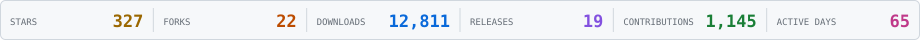
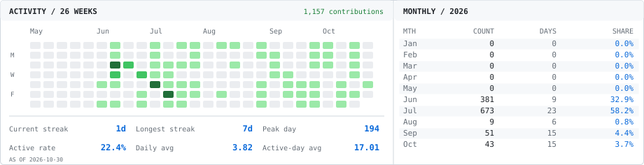
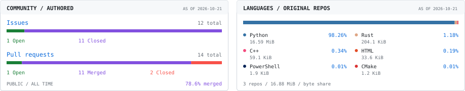
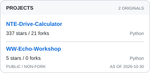
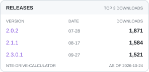
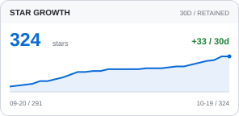
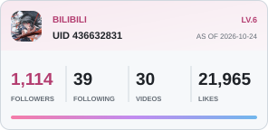
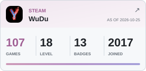
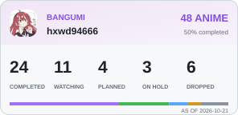

<picture>
  <source media="(prefers-color-scheme: dark)" srcset="assets/cards/overview-dark.svg">
  <source media="(prefers-color-scheme: light)" srcset="assets/cards/overview-light.svg">
  
</picture>

<picture>
  <source media="(prefers-color-scheme: dark)" srcset="assets/cards/activity-dark.svg">
  <source media="(prefers-color-scheme: light)" srcset="assets/cards/activity-light.svg">
  
</picture>

<picture>
  <source media="(prefers-color-scheme: dark)" srcset="assets/cards/insights-dark.svg">
  <source media="(prefers-color-scheme: light)" srcset="assets/cards/insights-light.svg">
  
</picture>

<a href="https://github.com/hxwd94666?tab=repositories"><picture>
  <source media="(prefers-color-scheme: dark)" srcset="assets/cards/projects-dark.svg">
  <source media="(prefers-color-scheme: light)" srcset="assets/cards/projects-light.svg">
  
</picture></a>
<a href="https://github.com/hxwd94666/NTE-Drive-Calculator/releases"><picture>
  <source media="(prefers-color-scheme: dark)" srcset="assets/cards/releases-dark.svg">
  <source media="(prefers-color-scheme: light)" srcset="assets/cards/releases-light.svg">
  
</picture></a>
<a href="https://github.com/hxwd94666/NTE-Drive-Calculator/stargazers"><picture>
  <source media="(prefers-color-scheme: dark)" srcset="assets/cards/star-growth-dark.svg">
  <source media="(prefers-color-scheme: light)" srcset="assets/cards/star-growth-light.svg">
  
</picture></a>

<a href="https://space.bilibili.com/436632831"><picture>
  <source media="(prefers-color-scheme: dark)" srcset="assets/cards/bilibili-dark.svg">
  <source media="(prefers-color-scheme: light)" srcset="assets/cards/bilibili-light.svg">
  
</picture></a>
<a href="https://steamcommunity.com/profiles/76561198402274250/"><picture>
  <source media="(prefers-color-scheme: dark)" srcset="assets/cards/steam-dark.svg">
  <source media="(prefers-color-scheme: light)" srcset="assets/cards/steam-light.svg">
  
</picture></a>
<a href="https://bgm.tv/user/hxwd94666"><picture>
  <source media="(prefers-color-scheme: dark)" srcset="assets/cards/bangumi-dark.svg">
  <source media="(prefers-color-scheme: light)" srcset="assets/cards/bangumi-light.svg">
  
</picture></a>

